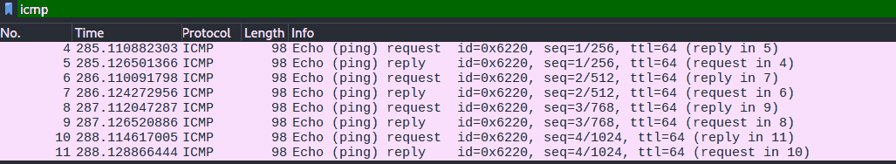
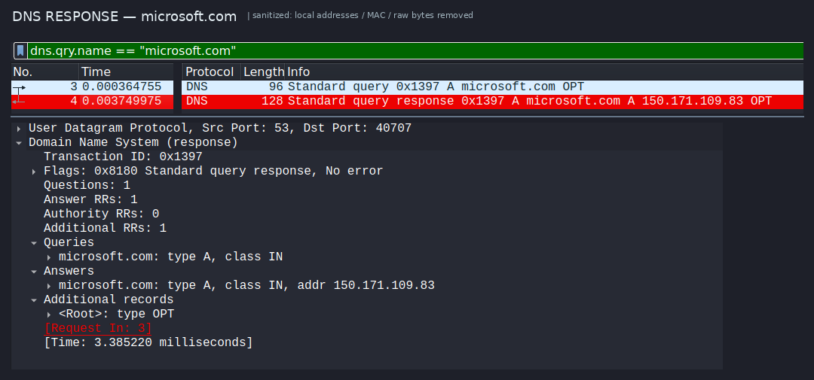
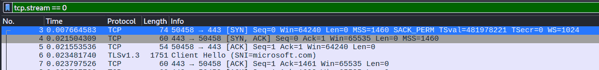
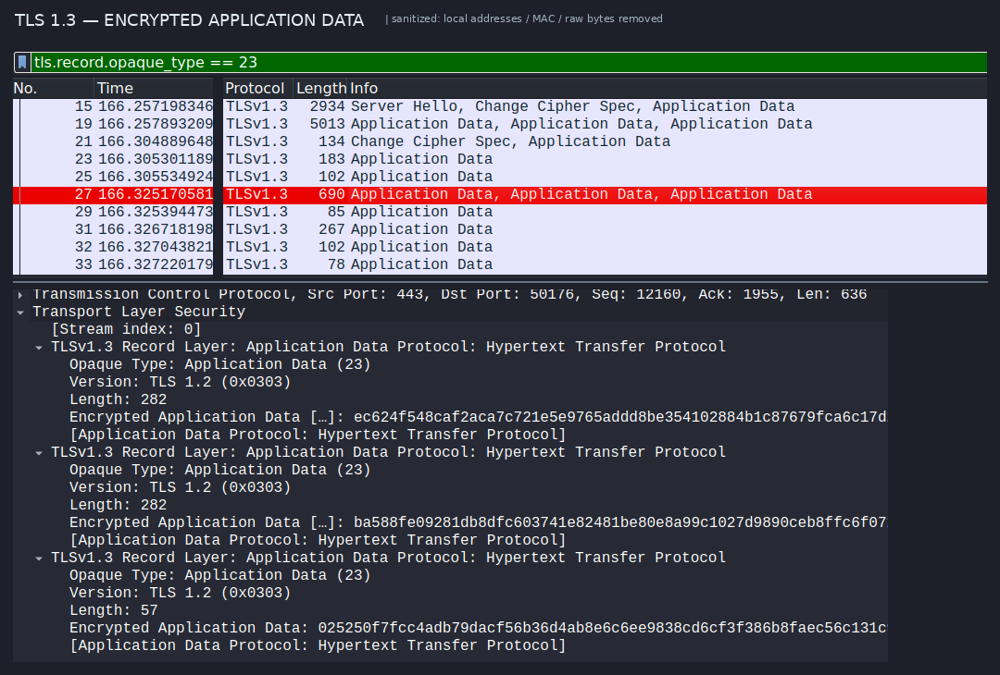
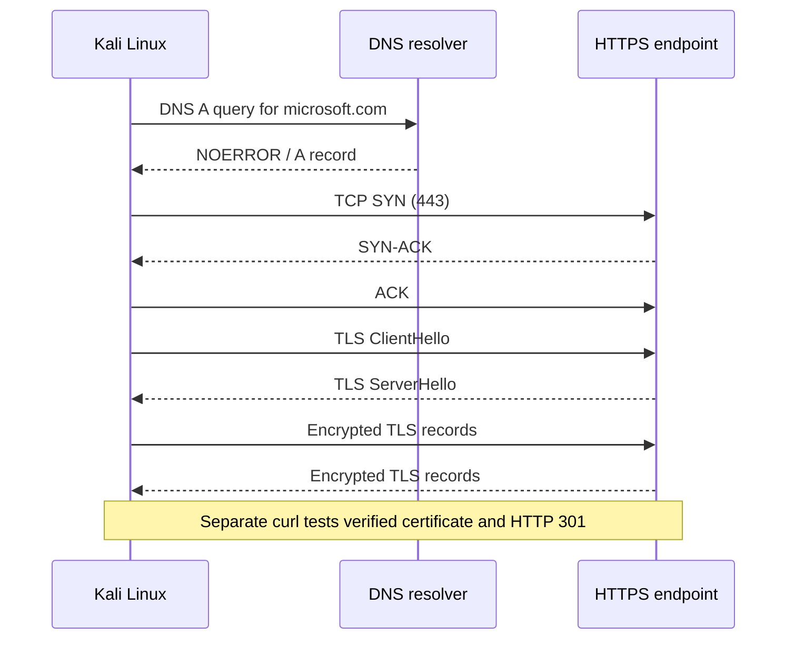

# Network Traffic Analysis Lab


**Tracing a real network connection from an ICMP reachability test and DNS resolution to TCP, TLS 1.3 and an HTTP response.**

A practical, evidence-based **Blue Team / Network Security** project built with Wireshark and Kali Linux. I generated authorized test traffic, inspected packets and correlated observations across network layers. This project focuses on *protocol analysis and documentation*, not simulated attacks or claims of compromise.

 > **Project status:** Analysis and documentation complete; nine sanitized screenshots are included as supporting evidence.

## Key findings

| Protocol / layer | Verified observation | Evidence |
| --- | --- | --- |
| **ICMP** | 4 Echo Requests and 4 matching replies; average observed RTT **14.63 ms** | [Packet capture](evidence/01-icmp-echo.png) |
| **DNS** | `microsoft.com` A query returned `NOERROR`. **7.186521 ms** in the initial test; **3.385220 ms** in a separate follow-up | [Query](evidence/02-dns-query.png) · [Response](evidence/03-dns-response.png) |
| **TCP** | Complete **SYN → SYN-ACK → ACK** to TCP/443; SYN-to-SYN-ACK interval **13.84 ms** | [Three-way handshake](evidence/04-tcp-handshake.png) |
| **TLS 1.3** | ClientHello, ServerHello and encrypted TLS records observed | [ClientHello](evidence/08-tls-client-hello.png) · [ServerHello](evidence/09-tls-server-hello.png) · [Opaque records](evidence/10-tls-application-data.png) |
| **HTTPS** | curl reported a valid hostname/certificate and TLS 1.3; a **separate** HEAD request received HTTP **301** | [Certificate check](evidence/06-https-certificate.png) · [HTTP status](evidence/07-http-301.png) |

**What this demonstrates:** packet inspection, request/response correlation, connection tracing, TLS metadata interpretation and reporting based on observed evidence.

## Evidence walkthrough

### 1. ICMP — Network reachability

Four matched ICMP Echo Request / Echo Reply pairs were observed when contacting `1.1.1.1`. This validates ICMP reachability for the specific test, **not** access to every service on the destination.



### 2. DNS — Name resolution

The follow-up capture shows an A-record query for `microsoft.com`, a matching response with transaction ID `0x1397`, response code `NOERROR` and an observed response time of **3.385220 ms**.



[View the matching DNS query](evidence/02-dns-query.png).

> An earlier, **different** DNS query (`0x28be`) measured **7.186521 ms**. Its timing must not be attributed to the screenshot above.

### 3. TCP — Connection establishment

A TCP three-way handshake was observed with SYN, SYN-ACK and ACK packets to port 443. The interval between SYN and SYN-ACK was approximately **13.84 ms**.



### 4. TLS 1.3 — Negotiation and encrypted records

The follow-up TLS capture shows a ClientHello with SNI `microsoft.com` and a ServerHello advertising **TLS 1.3**, cipher suite `TLS_AES_256_GCM_SHA384` and key share `X25519MLKEM768`.


[View the corresponding ClientHello](evidence/08-tls-client-hello.png).

The selected packet contains TLS records with **Opaque Type: Application Data (23)**:



In TLS 1.3, outer record type 23 can also carry encrypted handshake messages. It **does not** imply that the plaintext HTTP payload can be inspected. The record-version field `TLS 1.2 (0x0303)` is a legacy compatibility value; it does not contradict the negotiated TLS 1.3 version.

### 5. HTTPS — Certificate and application response

In a **separate curl session**, the local TLS client reported successful certificate/hostname verification and negotiated HTTP/2. A subsequent HEAD request returned **HTTP 301 (Moved Permanently)**; the redirect destination was not recorded.

[View certificate verification output](evidence/06-https-certificate.png).


## Connection flow (simplified)

This diagram illustrates the protocol sequence reconstructed from the findings. It does **not** imply that every screenshot came from the same TCP session.



## Lab environment and reproduction

| Component | Configuration |
| --- | --- |
| OS | Kali GNU/Linux **2026.3** |
| Packet analysis | Wireshark **4.6.6** |
| Capture interface | `eth0` |
| Tools | `ping`, `dig`, `curl` |
| Test endpoints | `1.1.1.1` and `microsoft.com` |

Start a **short capture on an interface you own or are authorized to monitor**, then run:

```bash
ping -c 4 1.1.1.1
dig microsoft.com
curl -4 -I -v https://microsoft.com
curl -4 -sS -o /dev/null -w 'HTTP status: %{http_code}\n' -I https://microsoft.com
```

**Wireshark display filters** (one at a time):

```text
icmp
dns.qry.name == "microsoft.com"
tcp.flags.syn == 1 && tcp.flags.ack == 0
tls.handshake.type == 1 || tls.handshake.type == 2
tls.record.opaque_type == 23
```

To inspect the **entire TCP connection**, select a relevant packet in Wireshark and use **Follow → TCP Stream**. The display filter will be `tcp.stream == N`, where `N` is the stream index assigned in **your own capture** (it is not always 0).

Results such as DNS answers, timings, TLS parameters and HTTP status codes may vary by execution and network.

## Documentation

| Resource | Purpose |
| --- | --- |
| [Technical report](reports/network-traffic-report.md) | Detailed packet interpretation, timing and limitations |
| [Lab walkthrough](docs/lab-01-basic-traffic.md) | Reproducible steps and display filters |
| [Portfolio case study](docs/case-study.md) | Short-form methodology, findings and outcome |
| [Evidence index and release checklist](evidence/README.md) | All **nine** screenshots and checks before public release |

## Scope and limitations

- All test traffic was intentionally generated in an authorized laboratory.
- **No malicious activity or security compromise was identified or claimed.**
- The screenshots provide protocol and TLS record **metadata**, not decrypted HTTP contents.
- The HTTP 301 result and curl certificate verification come from **separate requests**, not the Wireshark TCP stream used for handshake timing.
- Raw PCAP/PCAPNG files are excluded from version control. Nine sanitized screenshots are included. See the [evidence release checklist](evidence/README.md) for privacy checks.

---

*Independent educational project · Blue Team fundamentals · Evidence-based network analysis.*
