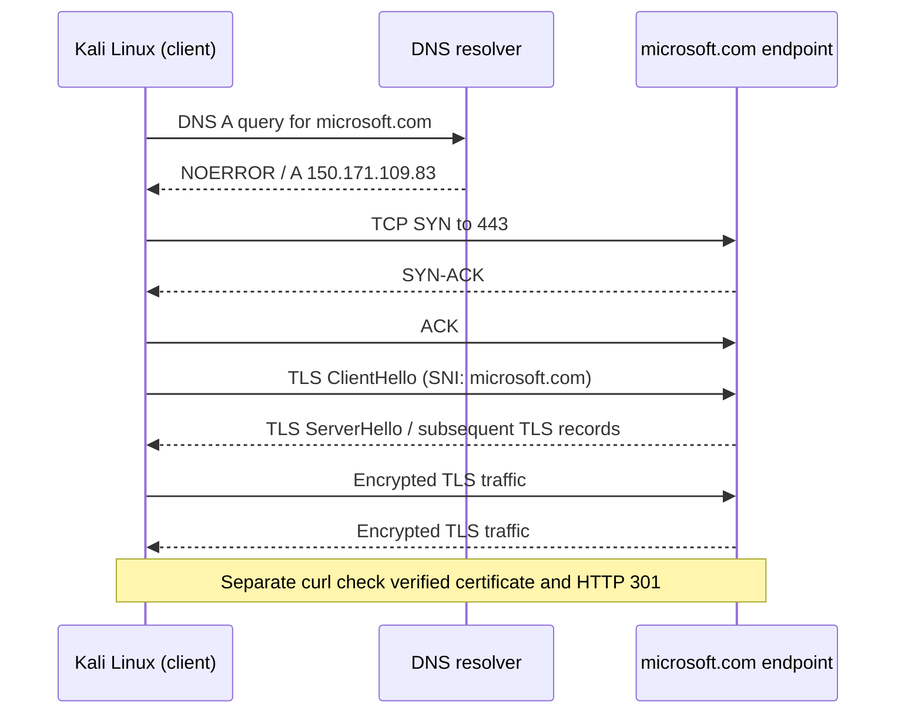
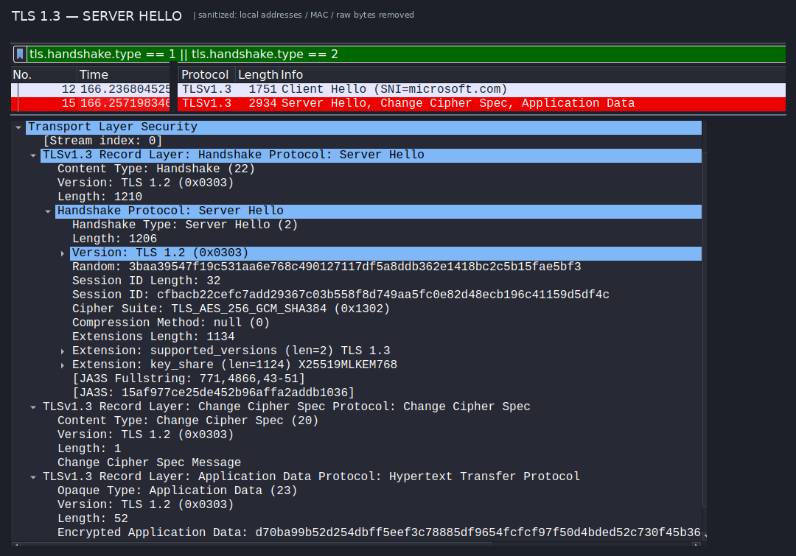
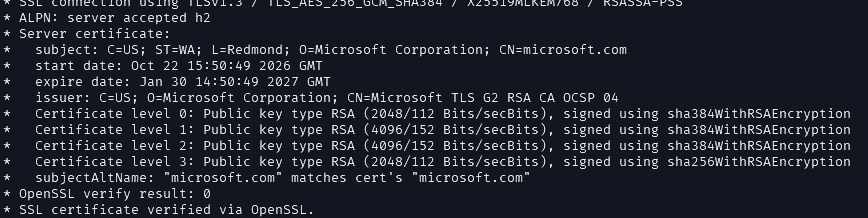
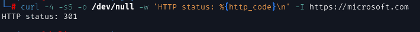

# Network Traffic Analysis Lab


**From DNS resolution to an HTTPS response: a packet-level investigation using Wireshark.**

A hands-on networking and Blue Team portfolio project that follows real, intentionally generated traffic through **ICMP, DNS, TCP, TLS 1.3 and HTTP/2**. Each finding below was checked against packet screenshots or terminal output from the lab.

> **Publication status:** The technical analysis is complete. This repository remains **private** while final privacy and technical checks are completed before public sharing.

## Investigation at a glance

| Layer / test | Observed result | Evidence |
| --- | --- | --- |
| ICMP reachability | 4 Echo Requests, 4 matching replies; mean observed RTT **14.63 ms** | Wireshark `icmp` capture |
| DNS resolution | `microsoft.com` returned `NOERROR` and an A record; **7.186521 ms** (initial) and **3.385220 ms** (follow-up) | Separate DNS query/reply captures |
| TCP transport | Full **SYN → SYN-ACK → ACK** to port **443**; SYN→SYN-ACK **13.84 ms** | TCP stream 0 |
| TLS security | **TLS 1.3** messages and encrypted application data observed | Wireshark + curl |
| Certificate check | Hostname match and **successful certificate verification** reported by curl | `curl -v` |
| HTTP | **301 Moved Permanently** returned to a HEAD request | Separate `curl -I` test |

These are observations from separate controlled tests. In particular, the last curl request is **not** the same TCP session as the original Wireshark stream.

## Network flow

The following sequence is a **reconstruction from the observed evidence**, not a packet screenshot.



## Lab setup

| Item | Observed / configured |
| --- | --- |
| Operating system | Kali GNU/Linux **2026.3** |
| Packet analyzer | Wireshark **4.6.6** |
| Capture interface | `eth0` |
| Test endpoints | `1.1.1.1` (ICMP), `microsoft.com` (DNS/HTTPS) |
| Auxiliary tools | `ping`, `dig`, `curl` |

The hypervisor and exact VM network mode have not been independently documented.

## Reproduce the tests

Start a short Wireshark capture on your **own authorized network interface**, then run:

```bash
ping -c 4 1.1.1.1
dig microsoft.com
curl -4 -I -v https://microsoft.com
curl -4 -sS -o /dev/null -w 'HTTP status: %{http_code}\n' -I https://microsoft.com
```

Useful **Wireshark display filters** (apply one at a time):

```wireshark
icmp
dns.qry.name == "microsoft.com"
tcp.flags.syn == 1 && tcp.flags.ack == 0
tcp.stream == 0
tls.handshake.type == 1 || tls.handshake.type == 2
tls.record.opaque_type == 23
```

**Note:** DNS answers, TLS configuration and HTTP responses can change with time, geography, cache and network configuration. Do not expect the same IP address or measurements in every run.

## Reviewed screenshots

All nine sanitized screenshots are present in the private repository under [`evidence/`](evidence/). The protocol images below illustrate **different controlled test sessions**; DNS timing values from the November follow-up must not be conflated with the earlier capture.

| Exercise | Evidence | Observation |
| --- | --- | --- |
| ICMP | [Echo Request / Reply](evidence/01-icmp-echo.png) | Four matched request/reply pairs |
| DNS | [Query](evidence/02-dns-query.png) · [Response](evidence/03-dns-response.png) | `microsoft.com`, NOERROR, A record, follow-up response **3.385220 ms** |
| TCP | [Three-way handshake](evidence/04-tcp-handshake.png) | SYN / SYN-ACK / ACK |
| TLS handshake | [ClientHello](evidence/08-tls-client-hello.png) · [ServerHello](evidence/09-tls-server-hello.png) | SNI, TLS 1.3 and negotiated cipher |
| TLS encrypted records | [Application Data](evidence/10-tls-application-data.png) | Opaque type **23** — encrypted TLS records |
| HTTPS verification | [Certificate validation](evidence/06-https-certificate.png) · [HTTP 301](evidence/07-http-301.png) | TLS certificate accepted by curl; HTTP permanent redirect |

### DNS resolution — follow-up capture


The earlier DNS capture measured **7.186521 ms** (transaction `0x28be`); this newer evidence measures **3.385220 ms** (transaction `0x1397`). These are **two different queries**.

### TCP three-way handshake


### TLS 1.3 ServerHello



The `TLS 1.2 (0x0303)` value visible in the TLS record's legacy version field is compatible with **negotiated TLS 1.3**.

### HTTPS certificate and HTTP response





The `301` status comes from a **separate** curl HEAD request. No destination from the `Location` header has been established.

## Documentation

- [Technical investigation report](reports/network-traffic-report.md) — packet evidence, observed fields, timing and limitations
- [Lab walkthrough](docs/lab-01-basic-traffic.md) — commands, capture steps and protocol filters
- [Case study for the portfolio](docs/case-study.md) — concise problem, methodology and outcome
- [Evidence handling guide](evidence/README.md) — required redaction checks before sharing screenshots

## Blue Team takeaways

1. **Correlation matters:** connect a DNS answer to an observed subsequent TCP destination, without assuming that DNS resolution alone proves service availability.
2. **Separate layers:** distinguish TCP establishment from TLS negotiation, certificate verification and HTTP application responses.
3. **Treat encrypted data accurately:** Wireshark exposes TLS metadata, not the decrypted HTTP payload by default.
4. **Report only what the evidence shows:** response status 301 was verified with curl; no redirect destination is claimed.

## Privacy and scope

- The lab uses traffic generated by the operator in a controlled environment.
- Real PCAP/PCAPNG files are excluded from version control to reduce accidental disclosure of IPs, MAC addresses, browsing history or credentials.
- Nine sanitized screenshot files are committed **in this private repository**. Perform a final review of the rendered images before changing visibility.
- This is a protocol investigation, **not** evidence of compromise or an incident-response engagement.

---

*Personal educational project. Lab documentation and evidence linked; final public-release review pending.*
